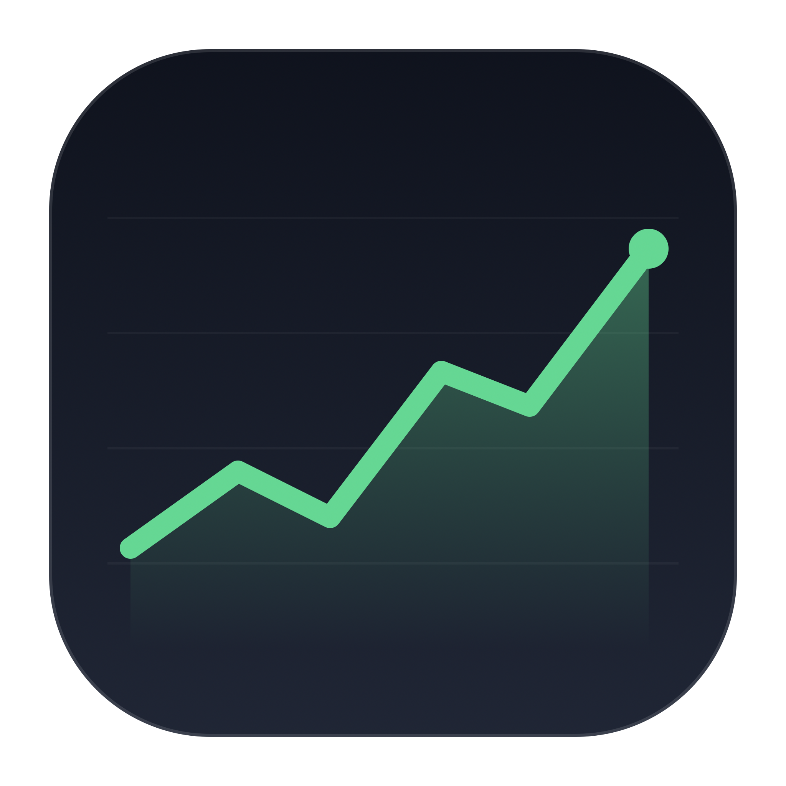
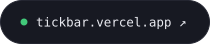
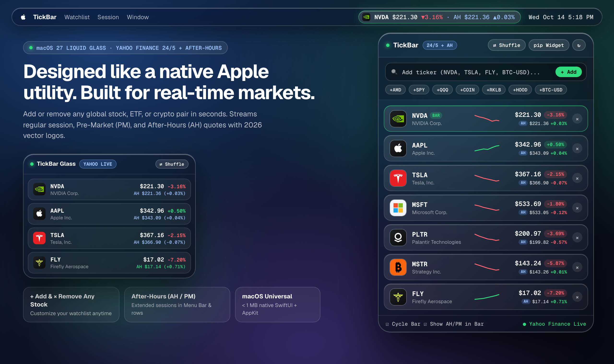
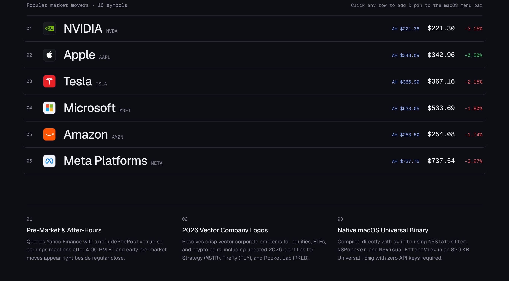
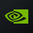
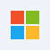
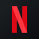
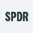
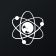

<div align="center">



# tickbar

**Live market & after-hours ticker for the macOS 27 menu bar.**

A native SwiftUI and AppKit utility that streams real-time Yahoo Finance regular, Pre-Market (`PM`), and After-Hours (`AH`) quotes with 2026 vector company emblems. Add or remove any global ticker in seconds, free and open-source.

[](https://tickbar.vercel.app/downloads/TickBar-macOS-Universal.dmg)
[](https://tickbar.vercel.app)
[](https://tickbar.vercel.app)
[](LICENSE)

<br />

<a href="https://tickbar.vercel.app/downloads/TickBar-macOS-Universal.dmg">
  
</a>
&nbsp;&nbsp;
<a href="https://tickbar.vercel.app">
  
</a>

<br /><br />



</div>

---

## 01 · Watchlist Customization

TickBar is never locked to a static list of tickers. Manage your symbols directly inside the macOS 27 menu bar popover:

| Control | Behavior |
| :--- | :--- |
| **`+ Add` Any Symbol** | Type any valid Yahoo Finance ticker (`NVDA`, `AAPL`, `TSLA`, `AMD`, `PLTR`, `FLY`, `RKLB`, `MSTR`, `SPY`, `QQQ`, `BTC-USD`, `ETH-USD`) into the search box and press `Return`. |
| **Quick-Add Chips** | One-click popular symbol pills (`+AMZN`, `+META`, `+GOOGL`, `+AMD`, `+NFLX`, `+COIN`, `+SPY`) sit below the input for instant additions. |
| **Pin to Menu Bar** | Click any stock row in the popover (or in the interactive web directory) to pin that ticker and its live `AH` / `PM` quote to the top macOS status bar. |
| **`×` Inline Remove** | Click `×` on the right side of any row to remove a ticker from your watchlist immediately. |
| **`⇄ Shuffle` Movers** | Sample a fresh random selection of active market movers with a single click. |

<p align="center">
  
</p>

---

## 02 · Pre-Market (`PM`) & After-Hours (`AH`)

Markets move outside the 9:30 AM to 4:00 PM ET bell. TickBar queries Yahoo Finance with `includePrePost=true` to stream:

- **Regular Session Quote & Sparkline** with a 30-point intraday vector chart and tabular percent change.
- **Extended Hours (`AH` / `PM`) Live Quote** rendered both in the popover list and inline inside the top macOS status bar (`NVDA $221.30 ▼3.16% · AH $221.36 ▲0.03%`).
- **24/7 Crypto Spot Feed** (`BTC-USD`, `ETH-USD`, `SOL-USD`) alongside US and international equities.

---

## 03 · 2026 Vector Company Logos

TickBar resolves high-contrast vector corporate emblems for your watchlist, including updated 2026 identities for Strategy (`MSTR`), Firefly Aerospace (`FLY`), Rocket Lab (`RKLB`), Palantir (`PLTR`), and Coinbase (`COIN`):

<div align="center">

| | Symbol | Company | | Symbol | Company | | Symbol | Company | | Symbol | Company |
| :---: | :--- | :--- | :---: | :--- | :--- | :---: | :--- | :--- | :---: | :--- | :--- |
|  | **`NVDA`** | NVIDIA |  | **`AAPL`** | Apple |  | **`TSLA`** | Tesla |  | **`MSFT`** | Microsoft |
|  | **`AMZN`** | Amazon |  | **`META`** | Meta Platforms |  | **`GOOGL`** | Alphabet |  | **`PLTR`** | Palantir |
|  | **`AMD`** | AMD |  | **`NFLX`** | Netflix |  | **`MSTR`** | Strategy |  | **`COIN`** | Coinbase |
|  | **`SPY`** | S&P 500 ETF |  | **`QQQ`** | Invesco QQQ |  | **`HOOD`** | Robinhood |  | **`SOFI`** | SoFi |
|  | **`RKLB`** | Rocket Lab |  | **`FLY`** | Firefly Aerospace |  | **`ASTS`** | AST SpaceMobile |  | **`BTC-USD`** | Bitcoin USD |

</div>

---

## 04 · Installation

### One-Line Terminal Installer (Recommended, Zero Gatekeeper Prompts)

```bash
curl -fsSL https://tickbar.vercel.app/install.sh | bash
```

### Direct Universal `.DMG` Installer

1. Download **[`TickBar-macOS-Universal.dmg`](https://tickbar.vercel.app/downloads/TickBar-macOS-Universal.dmg)**.
2. Open the `.dmg` disk image and drag **`TickBar.app`** to **`/Applications`**.
3. If macOS Gatekeeper blocks the first launch (unsigned/open-source build), run `xattr -cr /Applications/TickBar.app` in Terminal or allow it under **System Settings -> Privacy & Security -> Open Anyway**.

### Build from Source

Requires macOS 13.0+ and Xcode Command Line Tools (`swiftc`):

```bash
git clone https://github.com/anldrms/tickbar.git
cd tickbar
bash macos-app/build_dmg.sh
open public/downloads/TickBar-macOS-Universal.dmg
```

---

## 05 · Architecture

| Module | Path | Description |
| :--- | :--- | :--- |
| **macOS Menu Bar App** | [`macos-app/Sources/TickBar.swift`](macos-app/Sources/TickBar.swift) | Native SwiftUI + AppKit (`NSStatusItem`, `NSPopover`, `NSVisualEffectView`) with Yahoo Finance `v8/finance/chart` (`includePrePost=true`) and `v7/finance/quote` live feed |
| **Universal DMG Builder** | [`macos-app/build_dmg.sh`](macos-app/build_dmg.sh) | Compiles `arm64` + `x86_64` Universal binary (`lipo`), generates `.icns`, signs bundle, and packages `TickBar-macOS-Universal.dmg` |
| **Yahoo Finance Edge Proxy** | [`api/quotes.js`](api/quotes.js) | Serverless proxy returning real-time regular, Pre-Market (`PM`), and After-Hours (`AH`) quotes with intraday sparklines |
| **Interactive Web Directory** | [`public/index.html`](public/index.html) | Responsive `mkdir.directory`-inspired web stage (`Geist` + `Geist Mono`) with interactive popover and indexed market directory |

---

## License

Released under the [MIT License](LICENSE). Crafted by [anldrms](https://github.com/anldrms).
